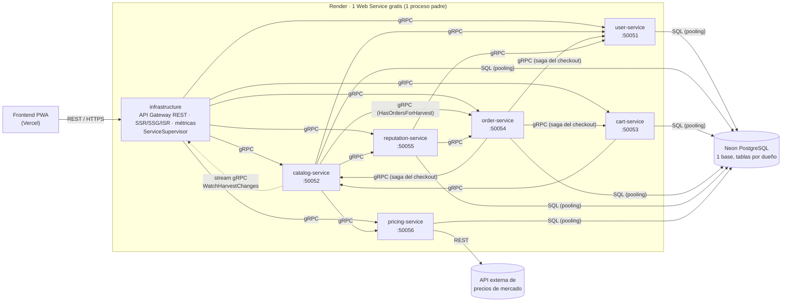

# Del Campo — Backend (microservicios gRPC)

API REST, microservicios y renderizado en servidor de la **plataforma de comercialización directa campesino–consumidor** (Caso de Estudio 3, Programación Orientada a la Web).

> Frontend: [DEL-CAMPO-FRONTEND](https://github.com/JulianMoreno627/DEL-CAMPO-FRONTEND-) (PWA en Vercel; no cambió con esta migración).
> Decisiones de arquitectura: [`docs/MICROSERVICIOS.md`](docs/MICROSERVICIOS.md) · Despliegue paso a paso: [`docs/DESPLIEGUE.md`](docs/DESPLIEGUE.md) · Migración de datos: [`scripts/migrate-to-neon.md`](scripts/migrate-to-neon.md) · Informe del avance 1: [`docs/INFORME-AVANCE-1.md`](docs/INFORME-AVANCE-1.md).

El código (clases, funciones, variables, archivos, rutas de la API, mensajes `.proto` y comentarios) está en inglés; los textos que ve el usuario y las URLs públicas, en español.

## Arquitectura

El backend es un **monorepo** de 6 microservicios en Node.js con estas reglas de comunicación:

- **Frontend → backend:** REST. Son las mismas rutas, cuerpos, códigos y formato de error `{error, type, current}` de antes.
- **Entre módulos:** **solo gRPC sobre HTTP/2**, con contratos en `proto/`.
- **Hacia terceros:** **solo REST** (la API de precios de mercado).



En Render Free los servicios gratis no pueden recibir tráfico privado y el proxy público no soporta HTTP/2. Por eso `infrastructure` arranca cada microservicio como **proceso hijo independiente**, con su puerto gRPC en `127.0.0.1`, y solo él escucha en el puerto público. Los detalles están en [`docs/MICROSERVICIOS.md`](docs/MICROSERVICIOS.md).

## Servicios

| Servicio | Responsabilidad | Puerto gRPC | Tablas propias | RPCs principales |
|---|---|---|---|---|
| **user-service** | Registro, login (token HMAC, scrypt), perfiles Producer/Buyer, cercanía | 50051 | `app_user`, `credential` | `Register`, `Login`, `GetUser`, `GetUsersByIds`, `ListProducers`, `NearbyProducers` |
| **catalog-service** | Cosechas y anuncios (máquina de estados, reservas), catálogo por temporada y cercanía, fotos, sincronización offline | 50052 | `harvest`, `sync_operation` | `ListListings`, `PublishListing`, `EditListing`, `DeleteListing`, `UploadListingPhoto`, `CreateHarvest`, `UpdateHarvest`, `GetCatalog`, `GetSeason`, `GetProducerProfile`, `GetHarvestsByIds`, `ReserveHarvest`, `ReleaseHarvest`, `ApplySyncBatch`, `WatchHarvestChanges` (stream) |
| **cart-service** | Carrito del comprador | 50053 | `cart` | `GetCart`, `AddItem`, `ChangeItemQuantity`, `RemoveItem`, `ClearCart`, `GetCartItems`, `EmptyCart` |
| **order-service** | Pedidos con precio congelado, ciclo de vida y **saga del checkout** con compensación | 50054 | `purchase_order` | `CheckoutCart`, `CreateOrder`, `ListOrders`, `ChangeOrderStatus`, `GetOrder`, `HasOrdersForHarvest` |
| **reputation-service** | Calificaciones bidireccionales (promedio bayesiano) | 50055 | `rating` | `Rate`, `GetReputation` |
| **pricing-service** | Precio justo (patrón Strategy) y precios de mercado por **REST** | 50056 | `market_price` | `GetReference`, `EvaluatePrices` |
| **infrastructure** | Orquestador (supervisor), API Gateway REST, SSR/SSG/ISR, métricas RUM | `PORT` (público) | — | — |

Todos los servicios implementan además el **Health Checking Protocol** de gRPC (`grpc.health.v1.Health`).

## Estructura

```
proto/                    Contratos gRPC compartidos (.proto)
packages/shared/          Utilidades SIN lógica de negocio: cargador de protos, servidor y cliente gRPC
                          con deadline, mapeo de errores de dominio ↔ status gRPC, contexto de la petición,
                          pool de pg para Neon, repositorios base, token de sesión, configuración
services/<name>-service/  Cada microservicio, con su package.json, test/ y:
  src/model/              entidades y reglas del dominio (POO)
  src/dto/                objetos de entrada/salida y su mapeo hacia/desde los mensajes .proto
  src/repository/         Repository: implementación PostgreSQL y en memoria
  src/service/            casos de uso
  src/controller/         recibe un DTO, llama al service y devuelve un DTO (sin gRPC)
  src/clients/            clientes gRPC hacia otros servicios (o REST hacia terceros)
  src/<Name>GrpcApi.js    ÚNICO archivo que conoce gRPC: registra el servicio y convierte mensajes ↔ DTO
  src/container.js        inyección de dependencias del servicio
  src/server.js           arranca el servidor gRPC (HTTP/2) en su puerto
infrastructure/           supervisor/, gateway/ (controllers REST ↔ gRPC, restMappers), render/, metrics/
db/schema.sql             Esquema PostgreSQL (idempotente; lo ejecuta infrastructure una vez)
test/integration/         Pruebas que cruzan servicios por gRPC (y contra PostgreSQL real con test:db)
```

Patrones: Repository, Strategy (precio justo), Observer (EventBus dentro de cada servicio y stream gRPC hacia el gateway), Saga (checkout), inyección de dependencias manual (`container.js` por servicio) y API Gateway.

## Ejecución local

Requisitos: **Node.js 20 o superior** (para `npm run dev` y `npm run test:db`, 22 o superior). No hace falta Docker.

```bash
npm install
npm run dev     # infrastructure + 6 microservicios, reinicia al cambiar código (lee .env si existe)
npm start       # igual, sin recarga (así arranca en Render)
npm run build   # genera la página SSG /temporada/ pidiendo los datos a catalog-service por gRPC
npm test        # todas las pruebas: shared, cada servicio, integración por gRPC, gateway y e2e
npm run test:db # pruebas contra PostgreSQL real (TEST_DATABASE_URL en .env.test; ver docs/DESPLIEGUE.md)
```

Sin `DATABASE_URL` todo funciona en memoria, con las cuentas demo:

- Productores: `rosa@`, `jose@`, `carmen@` y `luis@delcampo.co`.
- Compradores: `ana@`, `tienda@` y `restaurante@delcampo.co`.

Para usar Neon, copia `.env.example` como `.env` y completa `DATABASE_URL` y `TOKEN_SECRET`.

| URL | Patrón de rendering |
|---|---|
| `http://localhost:3000/temporada/` | **SSG**: HTML generado en `npm run build` |
| `http://localhost:3000/productores/p-rosa` | **SSR + ISR**: caché de 60 s, invalidada por el stream gRPC `WatchHarvestChanges` |
| `http://localhost:3000/api/...` | API REST JSON que consume el frontend (CSR) |

Las variables de entorno están documentadas en [`.env.example`](.env.example).

## Base de datos

Es **una sola base PostgreSQL en Neon** (plan Free, cadena con pooling y `sslmode=require`), y **cada servicio solo usa sus tablas** (ver la tabla de servicios). Se mantiene el control de concurrencia optimista (`version`, `updated_at`). El esquema está en [`db/schema.sql`](db/schema.sql).

## Perfiles e inicio de sesión

- **Productor** (`PRODUCER`): publica anuncios (producto, descripción, precio, cantidad y foto), confirma y entrega pedidos.
- **Comprador** (`BUYER`): ve los anuncios, los agrega al carrito y compra; cada producto comprado se convierte en un pedido para su productor.

La sesión es un token firmado (HMAC-SHA256) que el cliente envía en `Authorization: Bearer <token>`. Lo emite user-service y el **gateway lo verifica localmente** con el `TOKEN_SECRET` compartido. Luego propaga el usuario y el rol a los servicios en la metadata gRPC.

## API REST (sin cambios para el frontend)

| Método | Ruta | Servicio que responde | Descripción |
|---|---|---|---|
| GET | `/api/health` | infrastructure | Estado gRPC de cada servicio, de la base y memoria por proceso |
| POST | `/api/auth/register` | user | Crear cuenta: `{ role: 'PRODUCER'\|'BUYER', name, email, password }` → `{ token, user }` |
| POST | `/api/auth/login` | user | `{ email, password, role }` → `{ token, user }` (rechaza si el perfil no es el de la cuenta) |
| GET | `/api/auth/me` | user | Usuario de la sesión actual |
| GET | `/api/listings?q=` | catalog | Anuncios a la venta |
| GET | `/api/listings/mine` | catalog | Anuncios del productor, con lo vendido |
| POST/PATCH/DELETE | `/api/listings`, `/api/listings/:id` | catalog (+ order al borrar) | Publicar, editar o eliminar un anuncio sin pedidos |
| POST | `/api/listings/:id/photo` | catalog | Foto del anuncio (binaria, máx. 600 KB; viaja por gRPC como `bytes`) |
| GET/DELETE | `/api/cart` | cart | Ver o vaciar el carrito |
| POST | `/api/cart/items` | cart (+ catalog) | Agregar `{ listingId, quantity }` |
| PATCH/DELETE | `/api/cart/items/:listingId` | cart | Cambiar cantidad (0 = quitar) o quitar |
| POST | `/api/cart/checkout` | order (saga: cart + catalog + user) | Convierte el carrito en pedidos; todo o nada |
| GET/POST/PATCH | `/api/orders` | order (+ catalog) | Pedidos y su ciclo de vida (`PENDING → CONFIRMED → DELIVERED`, o `CANCELLED`) |
| POST | `/api/ratings` | reputation (+ order, user) | Reputación bidireccional |
| GET | `/api/users/:id/reputation` | reputation | Reputación de un usuario |
| GET | `/api/catalog?lat&lng&radiusKm&category&status&maxDays` | catalog (+ user, pricing) | Catálogo por temporada y cercanía, con precio justo |
| GET | `/api/season` | catalog | Cosechas agrupadas por mes |
| GET | `/api/producers/nearby?lat&lng&radiusKm` | user | Fincas cercanas |
| GET | `/api/producers/:id` | catalog (+ user, pricing, reputation) | Perfil, cosechas y reputación |
| GET | `/api/prices/:product` | pricing | Precio de mercado y rango justo sugerido |
| POST/PATCH | `/api/harvests`, `/api/harvests/:id` | catalog | Publicar o editar una cosecha |
| POST | `/api/sync` | catalog | Lote de operaciones offline: idempotente, con resolución de conflictos |
| POST/GET | `/api/metrics`, `/api/metrics/summary` | infrastructure | Web Vitals de usuarios reales (p75) |

Las rutas de escritura requieren la sesión.

## Despliegue

Es un solo Web Service gratis en Render (build `npm ci && npm run build`, start `npm start`) con la base en Neon. Los pasos manuales (crear Neon en la misma región que Render, migrar los datos, configurar variables y verificar `/api/health`) están en [`docs/DESPLIEGUE.md`](docs/DESPLIEGUE.md).
