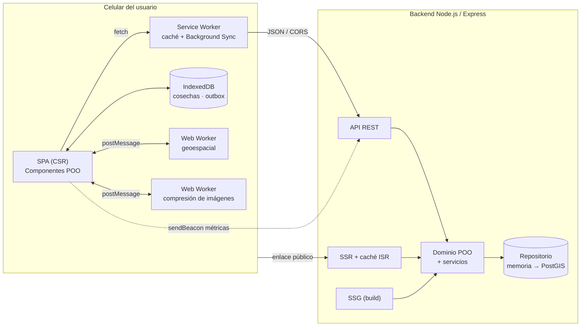
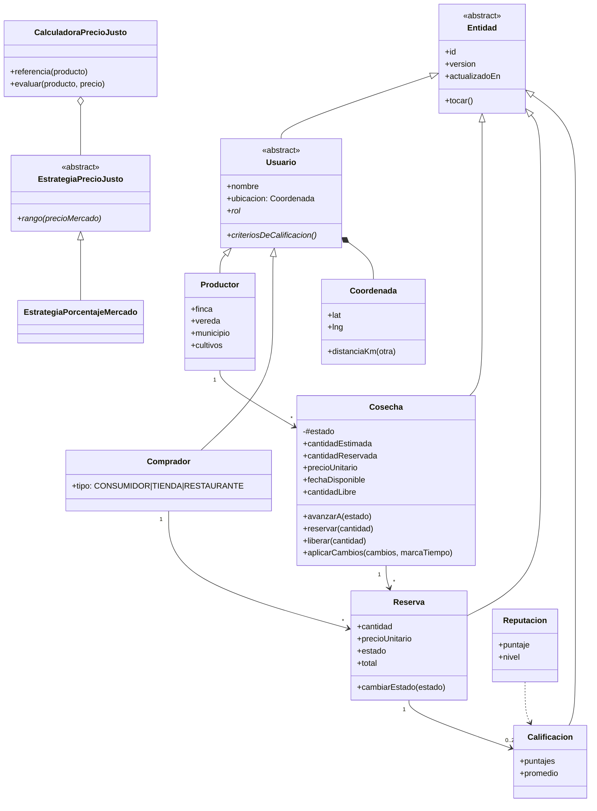
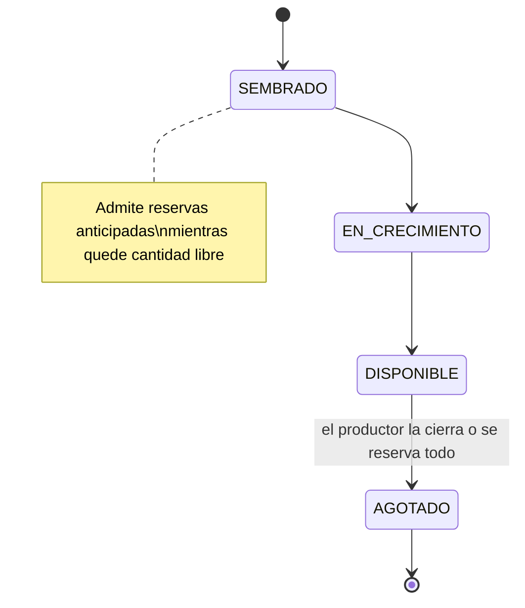
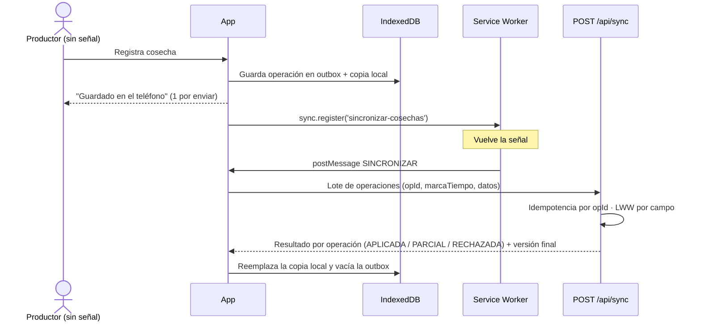

# Informe de Avance 1 — Plataforma de Comercialización Directa Campesino–Consumidor

**Asignatura:** Programación Orientada a la Web
**Caso de estudio:** 3 — Plataforma de comercialización directa campesino–consumidor ("Del Campo")
**Estudiante:** Julián David Moreno
**Fecha:** 13 de octubre de 2026
**Repositorios:** `plataforma-campesino-backend` · `plataforma-campesino-frontend`

---

## 1. Resumen

"Del Campo" conecta a pequeños productores con consumidores, tiendas de barrio y restaurantes, sin intermediarios. A diferencia de un e-commerce clásico, no vende inventario fijo: vende **cosechas futuras** con fecha estimada, que se pueden **reservar antes de estar listas**, y está pensada para **zonas rurales con señal intermitente y celulares de gama baja**.

En este primer avance se construyó un **prototipo funcional de punta a punta**, dividido en dos repositorios:

- **Backend:** API REST en Node.js/Express, con un dominio orientado a objetos y renderizado en servidor (SSR, SSG, ISR).
- **Frontend:** PWA *offline-first* con Service Worker, IndexedDB, dos Web Workers y medición de Core Web Vitals.

El avance está verificado con **18 pruebas automatizadas** en el backend y una **prueba de extremo a extremo en Chrome**, que registra una cosecha sin conexión, recarga la app sin señal y la sincroniza al volver la conexión.

## 2. Alcance del avance

| Funcionalidad del caso | Estado | Dónde |
|---|---|---|
| Perfil de productor (vereda, cultivos, próxima cosecha) | ✅ Implementado (página SSR pública) | `render/paginas.js`, `/productores/:id` |
| Catálogo por temporada | ✅ Implementado (CSR + calendario SSG) | `VistaCatalogo.js`, `/temporada/` |
| Precio de referencia justo | ✅ Implementado (patrón Strategy) | `dominio/PrecioReferencia.js` |
| Pedidos por lote / reserva anticipada | ✅ Implementado | `dominio/Cosecha.js`, `ReservaService.js` |
| Mapa de productores cercanos | ✅ Implementado (mapa SVG ligero, distancia Haversine) | `componentes/mapaLigero.js`, `geo.worker.js` |
| Reputación bidireccional | ✅ Implementado (promedio bayesiano) | `dominio/Reputacion.js` |
| Modo offline del productor | ✅ Implementado (outbox, Background Sync y resolución de conflictos) | `offline/`, `SyncService.js` |
| Base de datos PostgreSQL + PostGIS | 🟡 Esquema diseñado; persistencia en memoria por ahora | `db/schema.sql` |
| Notificaciones Web Push | 🟡 Manejadores en el Service Worker; falta el envío desde el servidor | `sw.js` |
| Autenticación | ⏳ Simulada con la cabecera `X-Usuario-Id` | `http/middlewares.js` |

## 3. Arquitectura general



**¿Por qué dos repositorios?** El frontend y el backend se despliegan y versionan de forma independiente. El frontend es estático y puede ir a un CDN; el backend expone una API con CORS configurado para el origen del frontend.

## 4. Programación orientada a objetos

### 4.1 Principios aplicados

| Principio | Aplicación concreta |
|---|---|
| **Abstracción** | `Entidad`, `Usuario`, `Repositorio`, `EstrategiaPrecioJusto` y `Componente` son clases abstractas: lanzan un error si se instancian directamente (`new.target`). |
| **Encapsulamiento** | El estado de la cosecha es un campo privado (`#estado`) que solo cambia mediante `avanzarA()` o `reservar()`, que validan la máquina de estados. Lo mismo con `#db` en `BaseDatosLocal` y `#estado` en `Almacen`. |
| **Herencia** | `Productor` y `Comprador` extienden `Usuario`, que extiende `Entidad`. Los errores forman una jerarquía (`ErrorDominio` → `NoEncontrado`, `TransicionInvalida`, `ConflictoVersion`), y cada uno conoce su código HTTP. |
| **Polimorfismo** | `criteriosDeCalificacion()` devuelve `calidad/cumplimiento` en un Productor y `pagoATiempo/seriedad` en un Comprador. Así se implementa la reputación bidireccional sin `if (rol === …)`. En el frontend, cada vista redefine `plantilla()`. |

### 4.2 Diagrama de clases del dominio



### 4.3 Máquina de estados de la cosecha

Este es el núcleo del modelo de negocio, que no es trivial porque no maneja un stock fijo:



Reglas: no se pueden saltar estados; no se puede estimar menos cantidad de la ya reservada; al reservar se congela el precio en la reserva; al cancelar, la cantidad vuelve a la cosecha.

### 4.4 Patrones de diseño

| Patrón | Dónde | Para qué |
|---|---|---|
| **Repository** | `Repositorio` → `RepositorioMemoria`, `RepositorioUsuarios` | Pasar a PostgreSQL/PostGIS sin tocar los servicios. |
| **Strategy** | `EstrategiaPrecioJusto` | Cambiar la fórmula del precio justo, por ejemplo a costo de producción + margen. |
| **Observer** | `BusEventos` (backend), `Almacen` y `GestorSincronizacion` (frontend, `EventTarget`) | Invalidar la caché ISR cuando cambia una cosecha; actualizar la UI cuando cambia la conexión o la cola. |
| **Factory** | `crearUsuario()` | Reconstruir el subtipo correcto (`Productor` o `Comprador`) desde datos planos. |
| **Inyección de dependencias** | `contenedor.js`, contexto del `Router` | Bajo acoplamiento y pruebas sencillas. |
| **Value Object** | `Coordenada`, `Reputacion` | Objetos inmutables definidos por su valor. |
| **Outbox** | Almacén `outbox` en IndexedDB | Ningún cambio offline se pierde. |
| **Template Method** | `Componente.montar()` → `plantilla()` / `alMontar()` | Ciclo de vida común para todas las vistas. |

## 5. Patrones de rendering

Cada pantalla usa el patrón que mejor se ajusta a su uso real:

| Patrón | Pantalla | Justificación |
|---|---|---|
| **CSR** (Client-Side Rendering) | Catálogo, Mi finca, Reservas, Rendimiento (`#/…`) | Son pantallas muy interactivas (filtros, reservas, edición offline). El catálogo se descarga una vez y se filtra localmente. |
| **SSR** (Server-Side Rendering) | Perfil público del productor (`/productores/:id`) | Llega como HTML listo para leer, sin ejecutar la SPA en un celular de gama baja. Es indexable y se puede compartir por WhatsApp. |
| **ISR** (Incremental Static Regeneration) | El mismo perfil SSR | Caché de 60 s con *stale-while-revalidate* e invalidación por evento cuando cambia una cosecha. La prueba automatizada verifica la secuencia MISS → HIT → invalidación → MISS. |
| **SSG** (Static Site Generation) | Calendario de temporada (`/temporada/`) | Cambia poco (por temporada). Se genera en `npm run build` y tiene costo cero por petición, así que se puede servir desde un CDN. |
| **Hidratación parcial (islas)** | Script mínimo en la página SSR | Solo las cantidades libres se actualizan con JS, porque el HTML de la caché ISR puede tener hasta 60 s de antigüedad. El resto de la página no ejecuta JavaScript. |
| **Code splitting** | `Router` con `import()` dinámico | Cada vista se descarga solo cuando el usuario la abre. |

## 6. Workers

### 6.1 Service Worker (`sw.js`)

| Recurso | Estrategia | Motivo |
|---|---|---|
| App shell (HTML, CSS, JS, workers) | Precache + *stale-while-revalidate* | La app abre al instante y sin señal. |
| Catálogo, perfiles, usuarios | *Network-first* con timeout de 4 s y respaldo en caché | Datos frescos si hay señal; si la red es lenta, la última copia sin dejar al usuario esperando. |
| Precios de referencia | *Stale-while-revalidate* | Cambian poco. |
| Fotos (`/uploads/`) | *Cache-first*, máximo 60 entradas | No se vuelven a descargar. |
| Escrituras y datos por usuario | Siempre a la red | Las escrituras las maneja la cola offline. |

También implementa **Background Sync** (avisa a la app que vacíe la cola al volver la señal) y los manejadores `push` y `notificationclick`, listos para Web Push.

### 6.2 Web Workers

| Worker | Tarea | Beneficio |
|---|---|---|
| `geo.worker.js` | Distancias (Haversine), filtro por radio y orden del catálogo | Cambiar el radio o la ubicación no hace nuevas peticiones (ahorra datos) ni bloquea la interfaz (mejora el INP). |
| `imagen.worker.js` | Redimensiona a 800 px y recodifica en WebP con `OffscreenCanvas` | Una foto de 3 MB queda en unos 100 KB antes de subirse, sin congelar el celular. |

`ClienteWorker` envuelve `postMessage` en Promises, empareja cada respuesta con su petición por id y crea el worker solo cuando se usa por primera vez.

## 7. Offline-first y resolución de conflictos



- **IDs generados en el cliente** (`crypto.randomUUID`): la cosecha existe desde el primer momento, aunque no haya red.
- **Idempotencia:** si una operación llega dos veces (por reintento), no se duplica.
- **Conflictos cuando dos dispositivos editan lo mismo:** se resuelven campo por campo con *Last-Writer-Wins*, según la hora en que se hizo cada cambio (aunque se haya hecho offline). Si el celular A cambió el precio a las 9:00 sin señal y el celular B lo cambió a las 10:00, gana B. Si A además cambió la descripción, ese campo sí se aplica. La app avisa al usuario qué campo perdió.
- **Reloj adelantado:** las marcas de tiempo futuras se recortan a la hora del servidor, para que un celular con la hora mal configurada no gane todos los conflictos.
- **Reintentos con espera exponencial** (2 s, 4 s, 8 s… hasta 60 s) para no gastar batería ni datos.

## 8. Métricas de rendimiento

| Qué se mide | Cómo |
|---|---|
| **LCP, CLS, INP, FCP, TTFB** (Core Web Vitals) | `PerformanceObserver` nativo, sin librerías. CLS con ventanas de sesión e INP por `interactionId`. |
| **Envío al servidor (RUM)** | `navigator.sendBeacon` al ocultar la página. Usa `text/plain` para evitar el preflight CORS. |
| **Resumen poblacional** | `GET /api/metricas/resumen` calcula el **percentil 75**, que es el criterio de Google, y lo califica con los umbrales oficiales. |
| **Tiempo de servidor vs. red** | Cabecera `Server-Timing` en todas las respuestas, leída desde `PerformanceResourceTiming.serverTiming`. |
| **Tiempo de render de cada vista** | User Timing API (`performance.mark` / `measure`) en el `Router`. |
| **Tareas largas** | `longtask` (más de 50 ms en el hilo principal). |

**Mediciones del prototipo** (Chrome, servidor local, vista *Rendimiento*):

| Medición | Resultado |
|---|---|
| FCP | 36 ms |
| TTFB | 11 ms |
| Tiempo de servidor de la API (`Server-Timing`) | 0,6 – 1,1 ms |
| Render de vistas CSR | 8 – 27 ms |
| 3 millones de cálculos de distancia en el Web Worker | 345 ms de cálculo, **0 ms de interfaz bloqueada** |
| Peso total del frontend (HTML + CSS + JS, sin minificar) | **78 KB** (solo React + ReactDOM minificados pesan unos 140 KB) |

**Hallazgo para la siguiente entrega:** en una sesión de prueba automatizada (sin clics reales, con navegación entre vistas) el LCP y el CLS de la sesión salieron "pobres". En una SPA, el contenido que llega después del indicador "Cargando…" desplaza la página y se cuenta como un nuevo LCP. El p75 de todas las visitas sí quedó "bueno" (LCP 56 ms, CLS 0,001). Como mejora se reservará espacio (*skeletons* con altura fija) para eliminar esos desplazamientos.

## 9. Diseño de bajo consumo de datos

- Fuentes del sistema (0 KB descargados); CSS propio de unos 5 KB, sin frameworks.
- Fotos comprimidas en el cliente (WebP, 800 px) y servidas con `loading="lazy"`, `decoding="async"` y dimensiones fijas (evitan CLS).
- Respeto de **Save-Data**: si el usuario activa "ahorro de datos", no se cargan fotos.
- Mapa en **SVG puro**: no se descargan teselas de mapa, que pesarían cientos de KB por vista.
- Compresión gzip en el servidor y revalidación por **ETag** (`304 Not Modified` sin cuerpo).
- El catálogo se descarga una vez; los filtros se resuelven localmente en el Web Worker.
- `GET` cacheados por el Service Worker: una visita repetida no vuelve a descargar el app shell.

## 10. Pruebas

- **18 pruebas automatizadas** (`npm test`, con `node:test`): máquina de estados, reservas, atomicidad de `aplicarCambios`, conflictos LWW, idempotencia del sync, permisos, reputación bayesiana, precio justo, Haversine, catálogo por cercanía, SSR/ISR (MISS → HIT → invalidación), Server-Timing y CORS.
- **Prueba de extremo a extremo** en Chrome mediante el protocolo DevTools:
  1. Un comprador reserva cosechas desde el catálogo.
  2. Un productor sin conexión registra una cosecha: queda guardada y marcada como "1 por enviar".
  3. Se recarga la página sin conexión: la app abre gracias al Service Worker y la cosecha sigue ahí.
  4. Vuelve la conexión: la cosecha se sincroniza sola y aparece en el servidor.

## 11. Trabajo pendiente (próximas entregas)

1. `RepositorioPostgres` con PostgreSQL + PostGIS (`ST_DWithin`, índice GIST) usando `db/schema.sql`.
2. Autenticación con JWT y roles, que reemplace `X-Usuario-Id`.
3. Web Push con claves VAPID: avisar cuando una cosecha reservada pase a DISPONIBLE (ya existe el evento `COSECHA_CAMBIADA`).
4. Skeletons de altura fija para bajar el CLS de la SPA; minificación y *hash* de archivos para caché inmutable.
5. Precios de mercado desde una fuente oficial (SIPSA – DANE).
6. Pruebas de rendimiento con red 3G simulada y Lighthouse en un celular de gama baja.

## 12. Cómo ejecutar

```bash
# Backend
cd plataforma-campesino-backend
npm install
npm start          # http://localhost:3000   (npm test para las pruebas)

# Frontend (otra terminal)
cd plataforma-campesino-frontend
npm start          # http://localhost:5173
```

Usuarios de demostración (selector en la parte superior): compradores *Ana Torres*, *Tienda Don Pedro* y *Restaurante La Huerta*; productores *Rosa Pérez*, *José Rincón*, *Carmen Suárez* y *Luis Gómez*.
